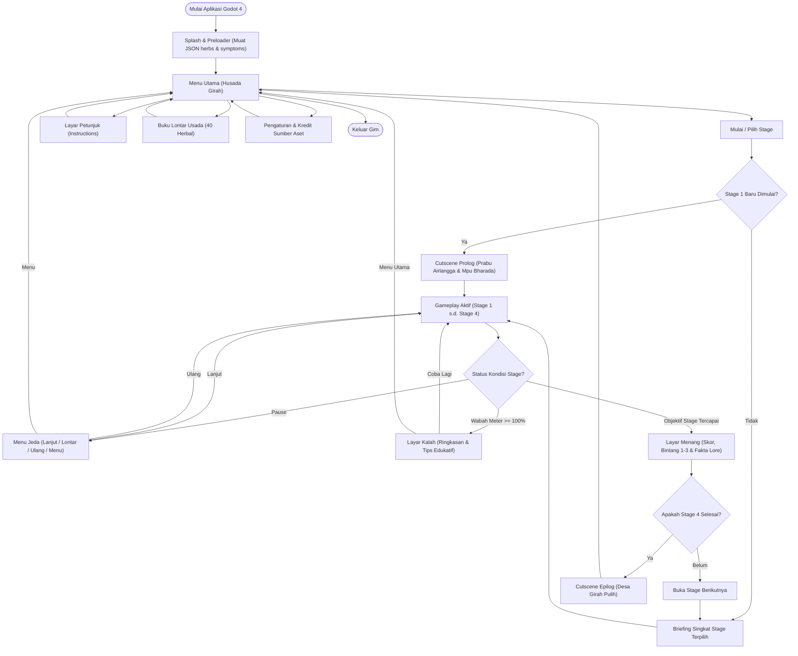
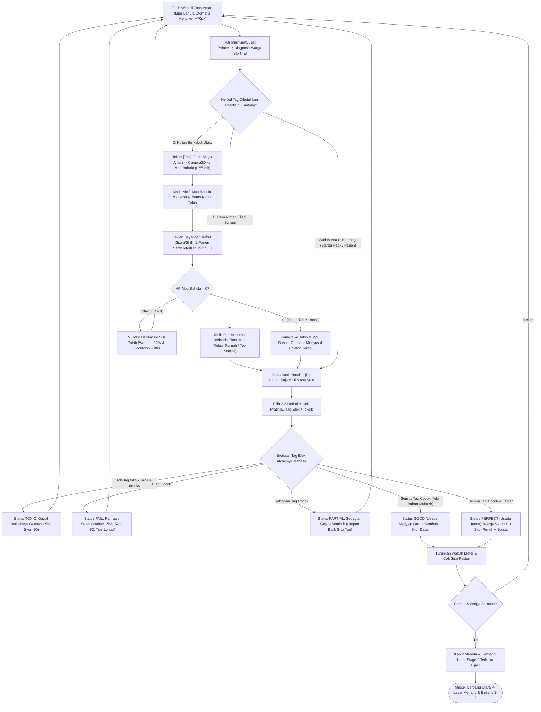
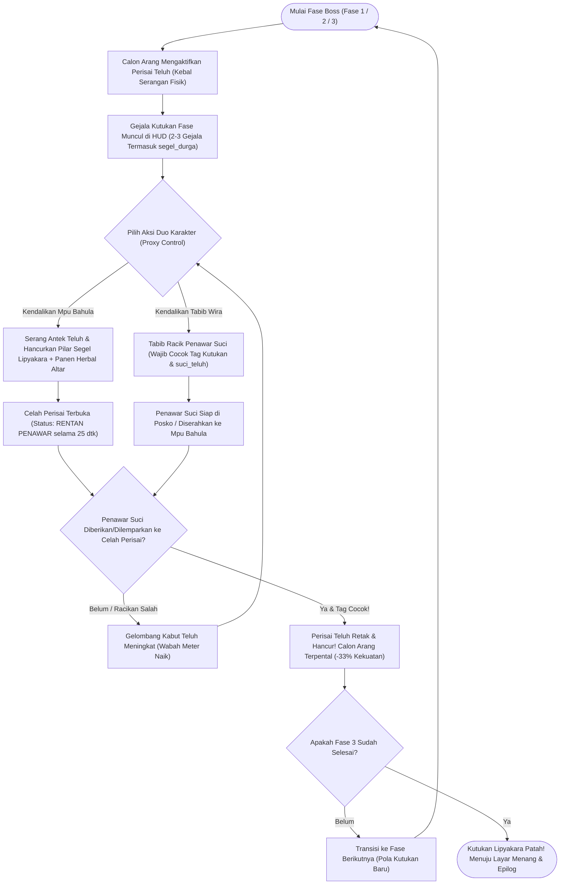

# Dokumen 04: Flowchart Alur Permainan & Rancangan Level (Stage 1–4)

**Acuan untuk:** Anggota 1 (Balancing & Kurva Kesulitan), Anggota 2 (State Machine, Scene Transition, AI Musuh & Boss), Anggota 3 (Desain Tilemap & Lingkungan 4 Stage)

---

## 1. Flowchart Alur Permainan Utama (*Main Game Flow*)

Diagram berikut menggambarkan navigasi tingkat atas mulai dari pemuatan awal gim (*Splash/Preloader*) hingga seluruh stage selesai dan mencapai epilog.



---

## 2. Flowchart Siklus Racik Kuali Portabel & *Follow-Then-Dispatch* (Versi Upgrade)

Diagram berikut menjelaskan siklus mikro (*micro gameplay loop*) di dalam Stage 1–3 pada peta luas terhubung, mencakup eksplorasi dengan Minimap/Quest Pointer, Mpu Bahula yang otomatis mengikuti Tabib (*Follow-Then-Dispatch*), peracikan kapan saja lewat **Kuali Portabel (`R`)**, hingga pembukaan Gerbang Utara menuju stage berikutnya.



---

## 3. Flowchart Mekanik Boss Fight Calon Arang (Stage 4)

Diagram khusus berikut menjadi acuan implementasi *state machine* Stage 4 (*Altar Kuil Durga*) yang memadukan pertarungan Mpu Bahula dengan alkimia cepat Tabib Wira.



---

## 4. Rancangan Detail Level (Stage 1 sampai Stage 4)

### 4.1 Stage 1 — Pinggiran Desa Girah (Peta Luas Terhubung `3200 × 2200` — Parameter Terluar Wilayah Girah)

- **Konteks Cerita:** Tabib Wira dan Mpu Bahula baru tiba di parameter terluar **Desa Girah** (Kerajaan Kahuripan) atas titah Prabu Airlangga dan arahan Mpu Bharada. Karena berada di pinggiran terluar, kadar wabah awal masih rendah (**Wabah Meter awal `10%`**, laju **`+0.25%/detik`**), namun kabut *teluh* mulai menyelimuti pinggiran hutan utara dan menghalangi jalan menuju Stage 2.
- **Arsitektur Peta (`3200 × 2200` px — Gaya 2D Top-Down Terbuka Zelda/Pokemon):** Peta luas yang menyatukan **4 ekosistem alami** dengan jaringan jalan setapak, 2 jembatan kayu, papan petunjuk kayu di persimpangan, **Minimap ringkas** di pojok kanan atas HUD, serta **Panah Penunjuk Arah (*Quest Pointer*)** dinamis.
- **Tujuan Pembelajaran:** Memahami diagnosa multi-gejala, pengenalan habitat alami herbal (kebun rumah vs. tepi sungai lembap vs. hutan berkabut), penggunaan **Kuali Portabel (`R`)** kapan saja & **Buku Lontar Usada (`L`)** (terbuka penuh), mekanik pendamping **Mpu Bahula (*Follow-Then-Dispatch*)**, serta pengenalan awal risiko `toksik` vs `detoks`.
- **Objektif Menang:** Menyembuhkan **4 Warga Sakit** (*Pak Kartono*, *Mbok Sari*, *Nyi Warni*, *Kang Jaka*) sehingga kabut utara mereda dan **Gerbang Jalan Utara menuju Stage 2 (Hutan Bambu & Sendang Girah)** terbuka bercahaya hijau, lalu melintasi gerbang tersebut sebelum *Wabah Meter* mencapai `100%`.

#### Peta Konseptual Stage 1 (`3200 × 2200` — 4 Ekosistem Terhubung)
```text
+-----------------------------------------------------------------------------+
|            [UTARA — PINGGIRAN HUTAN BERKABUT (ZONA BERBAHAYA)]              |
|                    [=== GERBANG UTARA -> STAGE 2 ===]                       |
|    [*] Sambiloto Barat      (x) Bayangan Tengah       [*] Sambiloto Utara   |
|    (x) Bayangan Barat       [Papan Hutan Utara]       (x) Bayangan Timur    |
|                                                       [!] Kecubung (Toksik) |
|~~~~~~~~~~~~~ BATAS KABUT TELUH (Hanya Mpu Bahula Melintas) ~~~~~~~~~~~~~~~~~|
| [PEMUKIMAN DESA PINGGIRAN — ZONA AMAN]             | [SUNGAI & TEPI LEMBAP] |
|  [R1 Kartono]+[H]Kunyit  [R2 Sari]+[H]Jahe   [R3]  | [H]Alang   ~~~SUNGAI~~ |
|    [P1 Pak Kartono]        [P2 Mbok Sari]   [P4]   | ===[Jemb. Utara]===    |
|  ======== JALAN LINTANG UTARA ========================>        [H]Meniran   |
|  [R4 Warni]+[H]Lengkuas  [Balai Desa]+[H]Kencur    | [H]Temulawak  ~SUNGAI~ |
|    [P3 Nyi Warni]         (@)Tabib + (X)Bahula     | ===[Jemb. Selatan]===  |
|  ======== JALAN LINTANG SELATAN ======================>        [H]Pegagan   |
|  (Kuali Portabel [R] & Lontar [L] dibawa terus)    | [R6 Peramu]+[H]Serai   |
+-----------------------------------------------------------------------------+
```

- **Sebaran Herbal Berbasis Ekosistem (14 Node Aktif di Stage 1):**
  - **Ekosistem Pemukiman & Kebun Rumah (7 herbal dapur alami):** `kunyit`, `jahe_merah`, `lengkuas`, `kencur`, `daun_sirih`, `serai_wangi`, `asam_jawa`.
  - **Ekosistem Aliran Sungai & Tepi Lembap (4 herbal lembap, 2 di sisi barat & 2 di seberang jembatan kayu timur):** `akar_alang_alang`, `meniran`, `temulawak`, `pegagan`.
  - **Ekosistem Pinggiran Hutan Berkabut Utara (Zona Berbahaya):** `sambiloto` (2 rumpun) dan `biji_kecubung` (1 rumpun bertag `toksik` untuk pembelajaran penetralan `detoks`).
- **Jenis Musuh:**
  - **3× Bayangan Kabut (*Barat, Tengah, Timur*):** HP `35`, berpatroli menjaga rumpun Sambiloto, jalan utara, dan Kecubung; serangan tabrak jarak dekat (`10 damage`), kalah dalam 2 tebasan Mpu Bahula.

---

### 4.2 Stage 2 — Hutan Bambu & Sendang Girah (Herbal Langka & Tanaman Beracun)

- **Konteks Cerita:** Wabah meluas dengan gejala baru (*Keracunan Bisa Gelap*, *Nyeri Kepala Menusuk*, *Igau Resah*). Tabib Wira memindahkan posko ke tepi Hutan Bambu menuju Sendang Girah demi mendapatkan rimpang langka, namun kawasan sendang telah dijaga makhluk hutan terpengaruh teluh dan dipenuhi tanaman beracun *Kecubung*.
- **Tujuan Pembelajaran:** Mengenal herbal kategori menengah/langka, mengelola pasien dengan 2 gejala kompleks, dan mempelajari keamanan bahan alam melalui mekanik tag **`toksik`** (*Kecubung* harus dihindari atau dinetralkan menggunakan tag `detoks`).
- **Objektif Menang:** Menyembuhkan **5 Warga/Pengungsi Sakit** (masing-masing membawa 2 gejala, termasuk gejala `racun_darah`, `nyeri_kepala`, dan `igau_resah`).

#### Peta Konseptual Stage 2 (Zona Aman vs. Zona Berbahaya)
```text
+-------------------------------------------------------------------+
| [BARAT LAUT - ZONA BERBAHAYA A]   | [TIMUR LAUT - ZONA BERBAHAYA B]|
|  Rumpun Bambu Pekat               |  Tepi Sendang Berkabut        |
|  (x) 2x Penjaga Rimbun            |  (x) 1x Murid Teluh Awal      |
|  [*] Brotowali, Bangle            |  [*] Biji Pala, [!] Kecubung  |
|~~~~~~~~~~~~~ BATAS KABUT TELUH ~~~~~~~~~~~~~~~~ BATAS KABUT ~~~~~~|
| [TENGAH - JALUR AMAN SENDANG & POSKO PENGUNGSI]                   |
|   [H] Temu Ireng, Lempuyang, Pegagan, Kumis Kucing, Daun Saga     |
|   [H] Kayu Secang, Cengkeh, Kapulaga, Lada Hitam, Bunga Melati    |
|   [P1..P5] Tenda Pengungsi (5 Pasien)                             |
| [SELATAN - POSKO ALKIMIA]                                         |
|   [Meja Alkimia]  [Mpu Bahula Standby]  [Gerbang Patroli Timur]   |
+-------------------------------------------------------------------+
```

- **Herbal Tersedia:**
  - *Zona Aman:* Herbal inti Stage 1 (stok dasar di posko) + herbal baru Stage 2: `temu_ireng`, `lempuyang`, `pegagan`, `kumis_kucing`, `daun_saga`, `kayu_secang`, `cengkeh`, `kapulaga`, `lada_hitam`, `bunga_melati`.
  - *Zona Berbahaya:* `bangle`, `brotowali`, `biji_pala`, dan **`biji_kecubung`** *(bertag `toksik` — disertai tanda peringatan visual aura ungu tipis)*.
- **Jenis Musuh:**
  - **Penjaga Rimbun (*Raksasa Akar Teluh*):** HP `60`, lambat namun serangan ayunan cabang area pendek (`15 damage`), mudah dihindari dengan *Dash* (`Shift`).
  - **Murid Teluh Awal (*Cantrik Girah*):** HP `45`, menembakkan proyektil kabut ungu lambat jarak menengah (`12 damage`) yang harus dihindari Mpu Bahula sebelum mendekat.

---

### 4.3 Stage 3 — Sekitar Pedepokan Girah (Misi Segel Kitab *Lipyakara*)

- **Konteks Cerita:** Di dekat kediaman Calon Arang, **Ratna Manggali** menemui Mpu Bahula dan Tabib Wira secara diam-diam. Ia mengungkapkan bahwa wabah makin parah karena 3 titik **Segel Kitab *Lipyakara*** di pelataran luar pedepokan memancarkan kutukan kabut pekat. Hanya herbal sakral Nusantara (`suci_teluh`) yang mampu menolong warga yang terjerat belenggu kutukan.
- **Tujuan Pembelajaran:** Meracik kombinasi untuk pasien **2–3 gejala** (memaksa pemanfaatan sinergi herbal multi-tag dalam batas 3 slot), mengenal herbal sakral (`daun_bidara`, `bunga_kenanga`, `kayu_cendana`), serta koordinasi intensif *Proxy Control* antara menonaktifkan segel dan mengobati warga.
- **Objektif Menang:** (1) Mpu Bahula menonaktifkan **3 Batu Segel *Lipyakara*** di zona berbahaya (setiap segel nonaktif memperlambat laju *Wabah Meter*), dan (2) Tabib Wira menyembuhkan **6 Warga Terkutuk** (termasuk minimal 3 pasien bergelaja `kutukan_kabut`).

#### Peta Konseptual Stage 3 (Zona Aman vs. Zona Berbahaya)
```text
+-------------------------------------------------------------------+
| [UTARA - PELATARAN PEDEPOKAN GIRAH (ZONA BERBAHAYA LUAS)]         |
|  [Segel 1] (x) Murid Teluh       [Segel 2] (x) Roh Lipyakara      |
|  [*] Daun Bidara, Temu Putih     [*] Kayu Cendana, Kulit Pule     |
|                                  [Segel 3] (x) Murid Teluh        |
|                                  [*] Bunga Kenanga, Pasak Bumi    |
|~~~~~~~~~~~~~~~ GERBANG BATU BERKABUT PEKAT ~~~~~~~~~~~~~~~~~~~~~~~|
| [TENGAH - LORONG TERSEMBUNYI RATNA MANGGALI (ZONA AMAN)]          |
|  [NPC Ratna Manggali (Pemberi Petunjuk)]   [P1..P6] 6 Warga Sakit |
| [SELATAN - POSKO GARIS DEPAN]                                     |
|  [Meja Alkimia]  [Rak Herbal Dasar S1-S2]  [Mpu Bahula Standby]   |
+-------------------------------------------------------------------+
```

- **Herbal Tersedia:**
  - *Zona Aman (Rak Posko & Sekitar):* Pasokan herbal penting Stage 1 & 2 (`jahe_merah`, `kunyit`, `temulawak`, `sambiloto`, `daun_sirih`, `pegagan`, `bunga_melati`, `brotowali`, dll.).
  - *Zona Berbahaya:* `temu_putih`, `daun_bidara` (`suci_teluh`), `pasak_bumi`, `kulit_pule`, `kayu_cendana` (`suci_teluh`), `bunga_kenanga` (`suci_teluh`), serta `biji_kecubung` (jebakan beracun).
- **Jenis Musuh:**
  - **Murid Teluh Girah:** HP `55`, menyerang dengan proyektil kabut kembar berpola jeda.
  - **Roh Penjaga *Lipyakara*:** HP `85`, bergerak cepat dalam pola garis lurus (*charge*) menjaga Batu Segel dan rumpun Kayu Cendana; menyala kuning sesaat sebelum menerjang sebagai sinyal *Dash*.

---

### 4.4 Stage 4 — Altar Kuil Durga (*Boss Fight* Calon Arang)

- **Konteks Cerita:** Klimaks di malam purnama di **Altar Kuil Dewi Durga**, Desa Girah. Calon Arang (*Walu Nateng Girah*) berdiri di pusat altar dengan kitab *Lipyakara* terbuka, diselimuti **Perisai Teluh** yang kebal terhadap senjata fisik biasa. Mpu Bharada memagari sisi selatan arena dengan lingkaran mantra suci sebagai **Posko Aman Tabib Wira**, sementara Mpu Bahula maju berhadapan langsung di arena altar.
- **Mekanik Inti Boss Fight:**
  1. **Perisai Teluh Kebal Fisik:** Jika Mpu Bahula langsung memukul Calon Arang saat perisai aktif, serangan memantul (`0 damage`) dengan efek tameng ungu + teks *"KEBAL! Buka celah Pilar Segel & gunakan Penawar Suci!"*.
  2. **Peran Mpu Bahula (Membuka Celah & Mengambil Bahan Altar):** Di kiri-kanan altar muncul **2 Pilar Segel** serta 1–2 antek teluh dan titik tumbuh herbal sakral **Wijaya Kusuma** (`bunga_wijayakusuma`) & **Kayu Cendana**. Mpu Bahula menghancurkan kedua Pilar Segel untuk memaksa Perisai Teluh **retak sementara (*Vulnerable Window* 25 detik)** dan memanen herbal altar bila stok kurang.
  3. **Peran Tabib Wira (Meracik Penawar Suci Dinamis):** Setiap fase menampilkan **Kombinasi Gejala Kutukan Aktif** milik Calon Arang pada HUD Boss. Tabib meracik **Penawar Suci** di Meja Alkimia Posko Selatan yang memenuhi seluruh tag kutukan fase tersebut (wajib mengandung `suci_teluh`).
  4. **Eksekusi Patahkan Perisai:** Setelah Penawar Suci selesai diracik, tombol interaksi muncul di Lingkaran Posko (Tabib menyerahkan/melontarkan energi penawar melalui Mpu Bahula saat celah perisai terbuka). Perisai Teluh hancur dengan efek ledakan emas, kekuatan Calon Arang berkurang 1/3, dan pertarungan berlanjut ke fase berikutnya!

#### Peta Konseptual Stage 4 (Arena Altar Kuil Durga)
```text
+-------------------------------------------------------------------+
| [UTARA - ALTAR KUIL DURGA (ZONA PERTARUNGAN BOSS)]                |
|        [Pilar Segel Kiri]    [[ CALON ARANG ]]    [Pilar Kanan]   |
|                              (Perisai Teluh)                      |
|   [*] Wijaya Kusuma                                [*] Cendana    |
|        (x) Antek Teluh (Spawn per Fase)                           |
|   [*] Daun Bidara                                  [*] Kenanga    |
|========= LINGKARAN MANTRA PELINDUNG MPU BHARADA (BATAS) ==========|
| [SELATAN - POSKO SUCI TABIB WIRA (ZONA AMAN)]                     |
|  [Meja Alkimia]   [Rak Herbal Nusantara S1-S3]   [Titik Serah     |
|                                                   Penawar Suci]   |
+-------------------------------------------------------------------+
```

#### Rincian 3 Fase *Boss Fight* Calon Arang

| Fase | Nama Fase | Gejala Kutukan Boss | Tag Penawar Suci Wajib | Pola Serangan Calon Arang | Contoh Kombinasi Penawar Valid (2–3 Bahan) |
| :---: | :--- | :--- | :--- | :--- | :--- |
| **Fase 1** | **Kabut Amarah** | `segel_durga` + `batuk_kabut` | `penenang`, `suci_teluh`, `anti_batuk` | Menembakkan 3 gelombang bola kabut lambat; memanggil 1 *Bayangan Kabut*; 2 Pilar Segel (HP 40). | `kayu_cendana` + `jahe_merah` atau `daun_bidara` + `kencur` |
| **Fase 2** | **Bisa *Lipyakara*** | `kutukan_kabut` + `nyeri_kepala` + `luka_ruam` | `detoks`, `suci_teluh`, `anti_nyeri`, `antiseptik` | Lingkaran kabut beracun di lantai altar (*telegraph* 1,5 dtk); memanggil 1 *Murid Teluh*; 2 Pilar Segel (HP 55). | `daun_bidara` (`antiseptik`, `suci_teluh`) + `brotowali` (`detoks`, `anti_nyeri`) atau `bunga_wijayakusuma` + `cengkeh` |
| **Fase 3** | **Murka *Walu Nateng Girah*** | `segel_durga` + `racun_darah` + `demam_panas` | `penenang`, `suci_teluh`, `detoks`, `anti_demam` | Kombinasi gelombang kabut menyebar + lingkaran lantai + 1 *Roh Penjaga Lipyakara*; 2 Pilar Segel (HP 70); laju *Wabah Meter* lebih cepat. | `bunga_wijayakusuma` (`suci_teluh`, `detoks`) + `bunga_melati` (`penenang`, `anti_demam`) atau `kayu_cendana` + `sambiloto` |

---

## 5. Kurva Kesulitan (*Difficulty Curve*) Stage 1–4

Tabel berikut merangkum parameter keseimbangan (*game balancing*) dari Stage 1 hingga Stage 4 sebagai acuan langsung pengisian `stages.json` di Godot 4:

| Parameter Balancing | Stage 1 (Desa Girah) | Stage 2 (Hutan & Sendang) | Stage 3 (Pedepokan Girah) | Stage 4 (Altar Kuil Durga) |
| :--- | :---: | :---: | :---: | :---: |
| **Kompleksitas Gejala** | 2–3 gejala ringan–menengah | 2 gejala ringan–menengah | 2–3 gejala (termasuk kutukan) | 2–3 gejala kutukan dinamis / fase |
| **Jumlah Pasien / Fase** | 4 warga + Gerbang Utara | 5 warga | 6 warga + 3 Batu Segel | 3 Fase Boss Fight |
| **Wabah Meter Awal** | `10%` *(parameter terluar)* | `20%` | `25%` | `20%` |
| **Laju Dasar Wabah Meter** | `+0.25% / detik` | `+0.50% / detik` | `+0.65% / detik` | `+0.75% / detik` (naik tipis di Fase 3) |
| **Wabah Meter saat Buka Kuali (`R`)** | `0%` *(jeda pengenalan)* | `25%` dari laju normal | `25%` dari laju normal | `25%` dari laju normal |
| **Frekuensi Proxy Control** | Rendah–Sedang (*Follow-Then-Dispatch*) | Sedang (2–3× ekspedisi) | Tinggi (3–4× ekspedisi + segel) | Sangat Tinggi (sinergi kontinu 3 fase) |
| **Kehadiran Risiko `toksik`** | Opsional uji (`biji_kecubung` di hutan utara) | Ya (`biji_kecubung` muncul) | Ya (`biji_kecubung` muncul) | Opsional (jika pemain bawa bahan) |
| **Variasi Musuh** | 1 jenis (Bayangan Kabut) | 2 jenis (Rimbun, Murid Awal) | 2 jenis (Murid Teluh, Roh Lipyakara) | Boss Calon Arang + Antek per fase |
| **Estimasi Durasi Bermain** | 4–6 menit | 6–8 menit | 8–10 menit | 7–10 menit |
